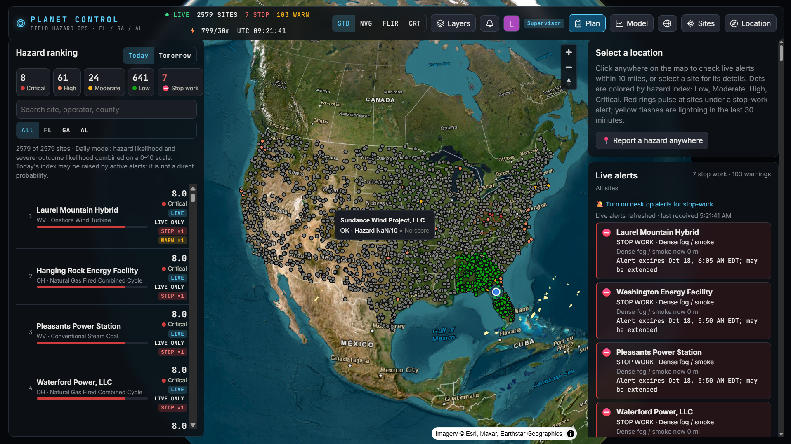
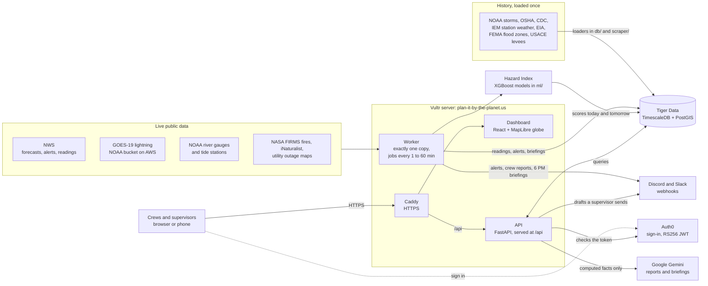

<h1 align="center">Plan It By The Planet (Planet Control)</h1>

<p align="center">
  SwampHacks 2026, Sperry Tech brief. Live weather and hazard intelligence for power-plant crews: instant stop-work alerts,
  a 6 PM briefing, and a plan for where to send crews and money first.<br/>
  Live at <a href="https://plan-it-by-the-planet.us"><b>plan-it-by-the-planet.us</b></a>
  NOTE: As of 10/24, this website has been taken down
</p>

<p align="center">
  
</p>

<p align="center">
  <br/>
  <sub>The dashboard: hazard ranking (left), 2,579 plants on the globe (FL/GA/AL scored by the model; gray = live alerts only), live alerts (right).</sub>
</p>

## Architecture



- **The worker** pulls every live feed on a schedule, raises the site alerts, writes the hourly Hazard Index scores and the 6 PM briefings, and posts to each user's Discord/Slack channels.
- **The API** serves the dashboard. It reads the database, and calls Gemini only with facts our code computed. Every number Gemini writes is checked against them.
- **The two share only the database:** they never call each other.

## Setup (virtual environment)

Use one Python virtual environment (`.venv`) for the whole project, so everyone runs the same Python with the same packages. Without it, `python` can point at different installs: this project hit a `No module named 'psycopg'` error because `python` was 3.14 while the packages were installed for 3.13.

### One-time setup

From the project root:

**Windows (PowerShell)**
```powershell
py -3.13 -m venv .venv
.venv\Scripts\Activate.ps1
python -m pip install --upgrade pip
python -m pip install -r requirements.txt -r backend/requirements.txt -r scraper/requirements.txt
```

If PowerShell refuses to run `Activate.ps1` ("running scripts is disabled on this system"), allow scripts for your user once, then activate again:
```powershell
Set-ExecutionPolicy -Scope CurrentUser RemoteSigned
```

**macOS / Linux**
```bash
python3.13 -m venv .venv
source .venv/bin/activate
python -m pip install --upgrade pip
python -m pip install -r requirements.txt -r backend/requirements.txt -r scraper/requirements.txt
```

Python 3.13 is what the project is tested with. Any 3.12 or newer should work.

### Every new terminal

Activate the environment first. Your prompt then starts with `(.venv)`, and plain `python` uses the project's packages:

```powershell
.venv\Scripts\Activate.ps1        # Windows
source .venv/bin/activate         # macOS / Linux
```

Check that it worked: `python -c "import sys; print(sys.executable)"` should print a path inside `.venv`.

### VS Code

Open the Command Palette (Ctrl+Shift+P), choose **Python: Select Interpreter**, and pick the one in `.venv`. New VS Code terminals will then activate it automatically.

### Other setup

- **Database:** the connection string goes in `.env` in the project root, as `DATABASE_URL=...`. Get it from a teammate privately, or see [Database (Tiger Data)](#database-tiger-data).
- **Git:** `.venv/` and `.env` are git-ignored. Never commit either one.
- **New packages:** after installing a package, add it to the matching `requirements.txt` (root for the ML model, `backend/` or `scraper/`) so teammates get it too.

## Project layout

| Folder or file | What it is | How to run |
|---|---|---|
| [frontend/](frontend/) | React + MapLibre globe dashboard: hazard ranking, live alerts, site cards, AI reports, crew reports with photos (see [Frontend](#frontend)) | `cd frontend; npm install; npm run dev` |
| [backend/](backend/) | Python FastAPI API and live-data worker (see [Backend](#backend-fastapi--live-data-worker)) | `python -m uvicorn backend.app:app --reload` and `python -m backend.worker` |
| [ml/](ml/) | **Hazard Index model** (site-day XGBoost, scores today and tomorrow into the DB), **answer key**, **economic impact** | see [Hazard Index model](#hazard-index-model) |
| [hardzardModel.py](hardzardModel.py) | First model (v0): one static score per plant, written to `data/hazard_scores.csv`. Replaced by `ml/hazard_model.py`; kept for reference. | `python hardzardModel.py` |
| [scraper/](scraper/) | Data collection scripts (power plants, weather, OSHA, CDC, EIA sales and demand) | see the sections below |
| [db/](db/) | Tiger Data (TimescaleDB) schema and loaders | `python db/setup_db.py`, `python db/load_history.py` |
| [docs/REQUIREMENTS.md](docs/REQUIREMENTS.md) | Brief → feature checklist with status, demo steps and checks | (none) |

| [deploy/vultr/setup.sh](deploy/vultr/setup.sh) | One-command server setup (Ubuntu + Caddy https + API + one worker) | `bash setup.sh <domain>` on the server |

> **Judging and deployment:** [docs/JUDGING.md](docs/JUDGING.md) (baseline slide, demo script, Q&A, hygiene checklist) · [docs/DEPLOY.md](docs/DEPLOY.md) (the Vultr server we run on; Render and DigitalOcean configs are kept as alternatives).

## Hazard Index model

[ml/hazard_model.py](ml/hazard_model.py) (version `site-day-xgb-v3`). One row per site per day: 1.11M site-days with a stored day-ahead forecast, October 2021 to October 2026. One XGBoost classifier per hazard category (severe storm, tropical, flooding, lightning, extreme heat, extreme cold, high wind), plus one for severe outcomes.

| | |
|---|---|
| **Label** | Did a recorded hazard happen near the site that day? A NOAA storm event, or an OSHA heat/cold/lightning injury, within the category's radius (the `site_hazard_events` ties). **Severe**: an event that killed or injured someone, did $1M+ damage, or an OSHA weather injury to a worker. |
| **Features** | Only what's known by 6 PM the day before, so training matches scoring: the day-ahead forecast at the site's station (high and low, heat index, hours at heat index 103°F or more, rain amount and chance, thunder chance, gusts, wind; `scraper/past_forecasts.py`), NWS watches and warnings issued by then (`scraper/nws_warning_history.py`), rain over the previous 6 days, season and location. |
| **Score** | `P_any = 1 − Π(1 − p_category)`, then **Hazard Index = 10 × [1 − (1 − P_any) × (1 − P_severe)^4]**. A severe outcome counts 4× an ordinary hazard event (a stated weight), so the index is **not a direct probability**. Each category also gets a score and its top weather drivers (SHAP contributions). Today's index is raised by active alerts, see the LIVE badge below. |
| **Economic link** | Each score carries the expected crew-hours lost and their cost: probability × hours lost per category × crew size × cost, using the labeled `economic_assumptions`. |
| **Split** | Trained on 2021–2024, tested on 2025–2026. Never a random split, because one storm hits many sites on the same day. |

```powershell
python -m ml.hazard_model train    # about 6 min; writes ml/models/*.json and metrics.json
python -m ml.hazard_model score    # writes today's and tomorrow's scores to hazard_scores (the worker does this hourly)
python -m ml.answer_key            # known-answer checks; exit code 1 if any fail
```

**Answer key** ([ml/answer_key.py](ml/answer_key.py)). The brief has no sample data with known results, so this is ours. Run it after every change:
- Four hurricane landfall days (Ian, Idalia, Helene, Milton) must rank in the top 2% of days for sites in the landfall counties. These are in the training years, so they're labeled *in-sample*.
- Out-of-sample test AUC must be at least 0.75 for the common categories.
- Predicted probabilities must match observed rates (calibration).
- Calm winter days must score low.
- Location must account for at most half of what the model uses.
- No site in today's top 10 may have unresolved coordinates.

## Economic impact

[scraper/economics.py](scraper/economics.py), [scraper/outages.py](scraper/outages.py) and [scraper/labor_costs.py](scraper/labor_costs.py) collect the data; [ml/economic_impact.py](ml/economic_impact.py) runs the analysis:

```powershell
python scraper/economics.py        # EIA: plant → company and grid operator, monthly sales, daily demand
python scraper/outages.py          # EAGLE-I outages, FL/GA/AL county-days (streams ~6 GB once, keeps a few MB)
python scraper/labor_costs.py      # BLS wages x benefits -> loaded labor cost per hour by state
python -m ml.economic_impact       # load into Tiger, weekly impact + correlations
```

Company data (crew trip logs, weekly sales, payroll) isn't public, so each gap has a **public stand-in**. Each stand-in is labeled as one in the API and UI, and is replaced the moment real data is loaded.

| Need | What's used now | Source | Replace with |
|---|---|---|---|
| **Crew trips** (restoration workload) | **Customer-hours without power** in the counties that hold each operator's sites, per week | [EAGLE-I](https://figshare.com/articles/dataset/24237376) (ORNL), 15-minute county snapshots, 2021–2025 | `data/crew_trips.csv` (`trip_id, site_id, started_at, ended_at, crew_size, purpose, cost_usd`) |
| **Weekly sales** | **Estimated weekly revenue** = weekly demand × that month's average retail price | EIA-930 daily demand × EIA-861M revenue ÷ MWh | company weekly sales (loader on request) |
| **Monthly sales** | Retail revenue and MWh per utility | EIA-861M | (real data) |
| **Labor cost** | Mean wage × benefits: **FL $58.33, GA $56.26, AL $56.65/hour** (US $63.19) | BLS OEWS 49-9051 (power-line installers and repairers) × BLS ECEC compensation ÷ wages (×1.43) | company payroll: `UPDATE economic_assumptions …` (BLS never overwrites a company value) |
| **Weather delays** | Stop-work weather days × hours lost per hazard × crew size × state labor rate | site weather + labeled assumptions | delay hours from work orders |

Correlations are reported raw and **deseasonalized**, meaning each series minus its same-month average. Summer heat and summer demand rise together anyway, so the useful question is whether an unusually hot or stormy week also had unusual demand, outages or revenue. Results (`GET /economics/correlations`):
- **Weather drives crew workload:** weeks with more stop-work weather have more customer-hours without power. Deseasonalized, 143–220 weeks each: Tampa Electric r = 0.71, Duke Energy Florida 0.69, FPL 0.51, Southern Co 0.50 (storm events vs outages reach 0.72 at Seminole Electric), all p < 10⁻¹². Smaller operators run 0.25–0.40; 11 of 13 are significant at p < 0.001.
- **Unusually hot weeks raise demand** at all four large operators: r = 0.33–0.38, p < 10⁻⁶.
- **Tampa Electric's unusually stormy weeks have lower demand:** r = −0.28, consistent with outages.
- **Monthly sales** at FPL, Georgia Power and Alabama Power rise in hotter-than-normal months (r ≈ 0.29–0.31, n = 58).

These are correlations, not proof of cause. The outage stand-in measures all restoration work in a county, not one company's crews.

**Experiment 3, the full write-up** (data, method, results, how to get real crew logs): [docs/EXPERIMENT_ECONOMIC_IMPACT.md](docs/EXPERIMENT_ECONOMIC_IMPACT.md). Added since:
- **Weather in real sales** (`python -m ml.weather_sales`): the degree-day model utilities use for their SEC "weather" line, on EIA-861M sales. Weather lifts the fit from R² 0.06–0.23 to 0.85–0.98 (Alabama Power 0.13 → 0.98). It priced Georgia Power's mild 2023 at −$147M.
- **Real crew dispatches** (worker job `crew_dispatch`): utilities' public outage maps (KUBRA: Alabama Power, Georgia Power, Mississippi Power, JEA; add any KUBRA utility in `backend/crew_dispatch.py`) give each outage near a site with the utility's own crew status and cause. Finished ones become `crew_trips` rows (`source = 'outage_map'`).
- **Assumptions you can change:** 📋 Plan → Economics → Assumptions (supervisors). Measured stop-work hours from the app's own alerts sit next to each assumed value.

### Did weather disrupt a crew contract?

**Hypothesis tested:** when a crew contract fails and a bad revenue quarter follows, a severe weather event (such as a tornado) near the work during the contract caused the disruption.

```powershell
python scraper/contract_data.py      # USAspending contracts, SEC quarterly revenue, OpenFEMA (no keys)
python -m ml.contract_disruption     # load into Tiger, fit, attribute -> ml/models/contract_disruption.json
```

| Need | Public stand-in | Size |
|---|---|---|
| Crew contracts and their failures | **USAspending.gov**: federal field-construction contracts performed in FL/GA/AL since FY2016. Covers utility and power lines, heavy civil, electrical and site work. Includes every change to each contract: terminations (default, cause, convenience, cancellation), change orders and end-date changes, with the county the work was in. | 7,647 contracts (7,049 fully observed); 2,395 disrupted (terminated, or 30+ days late not counting planned option years) |
| Revenue by quarter | **SEC EDGAR XBRL**: 8 public line-crew and field contractors (Quanta, MasTec, MYR, Dycom, Primoris, EMCOR, Granite, Sterling) and 4 utility parents (NextEra, Southern, Duke, Tampa Electric) | 34–49 quarters each |
| Storm damage | **OpenFEMA**: disaster declarations by county, and Public Assistance utility-repair projects | 3,430 declarations, 5,407 projects |
| Weather near the work | NOAA Storm Events files in `data/raw`, by county; zone events such as hurricanes are mapped to their counties | 2015–2026 |

**Method** ([ml/contract_disruption.py](ml/contract_disruption.py)):
1. Weather is counted during each contract's **originally planned** window. A late contract runs longer and would collect more storms *because* of the delay.
2. A logistic model controls for planned length, size, type of work, agency, state, start year and season. It tests whether contracts exposed to each kind of weather were disrupted more often.
3. **Evidence per contract.** A change document that names weather as the delay ("WEATHER TIME EXTENSION", "HURRICANE IAN IMPACTS") counts as **documented**. It's **documented + corroborated** when NOAA recorded that kind of storm in the county while the contract ran. A storm that merely overlapped is labeled **storm overlap only** and is never counted as the cause.

**Results:**
- **Overlap alone would mislead.** Raw numbers look like support: contracts with a tornado in their county were disrupted 44% of the time, vs 31% without. Most of that gap is contract length, because longer contracts see more storms *and* slip more. With the controls, no weather type significantly raises the odds of disruption (tornado odds ratio 1.12, 95% interval 0.98–1.27), and weather adds nothing to prediction (cross-validated AUC 0.704 with weather, 0.706 without).
- **The original rule is wrong about 95% of the time.** Of 809 disrupted contracts with a tornado nearby, only **4.6%** say in their own documents that weather caused the delay. The rate for all disrupted contracts is 3.8%.
- **91 disruptions are attributed to weather from the evidence.** 16 are documented + corroborated: 12 tropical, such as Hurricane Ian's landfall on 2022-09-28, and 4 flooding. 75 are documented as general weather delays.
- **Revenue:** no company shows a consistent "storm, then bad quarter" pattern. For crew contractors, storms tend to come with **more** revenue (restoration work): Primoris, next quarter, Spearman 0.42, p = 0.01, one of 24 tests, so it may be chance. The public contractors hold almost none of these federal contracts (1), so a contract failure can't be traced to a company's revenue with public data.

**What would make this definitive:** the utility's own crew contracts, with start and end dates, site, contractor, and outcome. With them, the same pipeline runs unchanged on real data. Load them in place of `data/field_contracts.csv` with the same columns.

API: `GET /economics/contract-disruption` (summary), `GET /sites/{id}/contracts` (contracts in the site's county with their evidence). The site card shows them under **Economic impact**.

**Restoration bounceback** (`python -m ml.bounceback`): is business above normal in the months after a storm? Three tests:
- field contracts in the hit county
- national crew contractors' revenue
- the sites' utilities' revenue

Not supported: no bounce in any of the 15 tests. An early "hail +31%" turned out to be the September fiscal-year-end spike in federal contract awards. The full process, data and results of both experiments are in [docs/EXPERIMENTS.md](docs/EXPERIMENTS.md).

## AI safety report (on tap)

`POST /sites/{id}/report` ([backend/reports.py](backend/reports.py)). Code gathers every fact and **decides go / caution / no-go**; Gemini only explains it. Each fact group has a source ID (`S1`–`S7`) that the report must cite, and the assumptions it relies on are listed. A **number audit** flags any number in Gemini's text that isn't in the facts (`verified: false`, with `unverified_numbers`). Gemini gets two retries per model, then the fallback model is tried, then a deterministic template report is used. Reports are kept until the next 6 PM at the site (when the next briefing goes out) and replayed until then; **Regenerate** writes a new one.

Set `GEMINI_API_KEY`, and `GEMINI_MODEL` / `GEMINI_FALLBACK_MODEL`; check Google's current model names. Without a key, the template report is returned.

## Compliance next steps (on tap)

`POST /sites/{id}/compliance` ([backend/compliance.py](backend/compliance.py)) turns OSHA reports near a site, plus the site's open crew reports, into a prioritized action list for a supervisor.

| Part | Decided by | Details |
|---|---|---|
| Which reports count | code | OSHA Severe Injury Reports tied to the site (within the crew-hazard radius), and crew reports open in the last 30 days |
| Priority per category | code | points = 5 × open crew reports + OSHA reports in the latest 12 months of data + 3 × amputations or eye losses in 3 years. **High** if any open crew report or 15+ points, **medium** at 5+, otherwise **low**. |
| Next steps and standards | code (playbook) | Per category, with the federal standard to check. For example, PPE → 29 CFR 1910.132, 1926.95, 1926.501–502, 1910.269(g). Heavy machinery → 1926.600–602, Subpart CC, 1926.453, 1910.178, 1910.147. Spills → 1910.22, 1926.25. Heat → General Duty Clause and the OSHA heat National Emphasis Program. |
| Reporting deadlines | code | 29 CFR 1904.39: a fatality within 8 hours; a hospitalization, amputation or eye loss within 24 hours. Highlighted when a severe crew report is open. |
| Explanation and order | Gemini (optional) | Uses only the facts and playbook, cites sources (O = OSHA, C = crew, P = playbook), passes the same number audit, and falls back to a template |

OSHA time windows end at the **latest OSHA report on file** (currently Nov 30, 2025), not today, because the public data lags. Supervisors close the loop with `PATCH /crew-reports/{id}` (`resolved` or `dismissed`), which also clears the alert the report raised. This is guidance to act on, not legal advice.

**To show actual citations instead of injuries:** the OSHA data here records *injuries*. Cited *violations* are in the Department of Labor's OSHA enforcement data (free key from [dataportal.dol.gov](https://dataportal.dol.gov)). With a key, they can be added as another source.

## Frontend

[frontend/](frontend/) is a React (Vite) app on a **MapLibre GL globe**, styled after an ops-room HUD with Lucide icons and Inter / JetBrains Mono type. The basemap is keyless **Esri satellite imagery** with place and road labels. It opens on North America and is wired to every backend endpoint.

```powershell
python -m uvicorn backend.app:app --reload     # terminal 1: API (add $env:PLANIT_DEV="1" for demo controls)
cd frontend; npm install; npm run dev          # terminal 2: open http://localhost:5173
```

| Feature | What it does | API |
|---|---|---|
| **Hazard ranking** (the dashboard requirement) | All 694 plants ranked by Hazard Index, **Today or Tomorrow**. Band tiles (Critical / High / Moderate / Low / Stop work) double as filters. State filter and search. Each row shows its hazard bar, band label, top hazard and alert badges. Click a row to fly to the site. | `GET /sites?horizon=` |
| **Your briefing** (supervisors, 6 PM) | Full-screen briefing across your current area and every saved location (of the identity you're acting as), written by Gemini from computed facts (numbers checked; template fallback). Pops up for supervisors at **6 PM local** once a day, and is **replayed** (Account → 📋 Replay 6 PM briefing) until the next 6 PM, when the next request writes a fresh one. Supervisors get a **drafted crew message per Discord/Slack channel**: edit, then Send. **↻ Run again** rebuilds it now. Debugging: 🧪 Briefing next to the identity chip, shown only in demo mode (`PLANIT_DEV=1`). | `POST /me/briefing`, `POST /me/channels/{id}/send` |
| **AI answers are replayed** | The AI safety report, Compliance and the briefing are each kept until the next 6 PM at the site, then rewritten on the next open; Regenerate / Run again forces it. The browser keeps the last copy of each, shown (marked offline) when the API can't be reached. | server: `site_reports`, `user_briefings`; browser: `planit.ai.*` in localStorage |
| **Supervisor plan** (Plan in the header) | Where to focus attention and resources first, for the sites in view. **Economics**: crew-hours and dollars at risk this week, yearly weather loss by utility, weather in real sales, real crew dispatches, the experiments' findings, and the assumptions panel (supervisors edit; `PUT /economics/assumptions/{key}`). This week also shows at-risk crew-hours and dollars per site. **Act now**: sites with alerts or a high live score, with what to do and what to bring. **This week**: a 7-day grid of heat ☀️, storm ⚡, heavy-rain 🌧 and wind 💨 days, plus what to schedule or stage ahead (floodplain 🌊 and levee 🧱 sites flagged before heavy rain). **Invest**: sites ranked by crew time lost to weather in a typical year, the costliest hazard, a suggested fix, its cost and payback (fix costs are labeled assumptions in `economic_assumptions`). | `GET /plan/{now,week,invest,economics}` |
| Globe | Plants colored by band, pulsing red rings on stop-work sites, lightning from the last 30 min, your GPS location, a draft report pin. The globe button returns to North America, **Sites** fits all sites, **Location** picks a new area. Sites outside FL/GA/AL (once loaded) carry a **LIVE ONLY** badge: live data, no model score. | `/sites`, `/lightning/recent` |
| Site card | Today and tomorrow scores (flagged if a score isn't for today or tomorrow), what drives the score (weather drivers), expected crew impact (labeled estimate), live alerts with their timing, 48 h forecast chart (with a table view), 6 PM briefing, site history, economic impact, crew reports with photos | `/sites/{id}`, `/forecast`, `/briefings/{id}`, `/economics`, `/crew-reports` |
| **Compliance** | Prioritized next steps from OSHA reports nearby and open crew reports, with the OSHA standards to check and reporting deadlines. Crew reports can be marked resolved or dismissed. | `POST /sites/{id}/compliance`, `PATCH /crew-reports/{id}` |
| **Model accuracy** (Model in the header) | Walk-forward backtest table: how well each model version predicted real outcomes | `GET /model/backtest` |
| **Weather scanner** (site card) | Right now at the site's station; the past 7 days measured and the next 7 days forecast, as one chart with a measured/forecast divider; a daily table (high/low, rain, gust, thunder); nearest lightning in the last 30 min with distance, direction and counts within 10/20 mi. Opening a site pulls fresh NWS data if it's stale (and back-fills the week); the worker refreshes each site at 6 PM local, right before its briefing. | `GET /sites/{id}/weather` |
| **LIVE / UNUSUAL badges** | **LIVE**: today's score was raised by an active alert or crew report (hover for why). The floor is graded by proximity and intensity: stop work 8–10 (lightning at the site 10, at the 10-mi edge 8), warnings 5–7 (from the warn to the stop threshold, e.g. 2 → 4 in of overnight rain), an open crew report 4, a river at action stage 3.5. **UNUSUAL**: in the top 10% of that site's normal range for the month. | `GET /sites` |
| **AI safety report** | GO / CAUTION / NO-GO decided by code, hazards with source chips, actions, uncertainty, assumptions, number-audit badge, regenerate | `POST /sites/{id}/report` |
| **Crew hazard report** | Category, description, severity, location (site / GPS / tap the map to pin), optional photo. **Web:** attach a photo. **Phone:** *Take photo* (camera) or *Choose from library*. Photos are shrunk to ≤1600 px JPEG on the device before upload. The site is alerted immediately, unless the report is too vague to act on (fewer than 3 real words, or no mention of its hazard; `backend/report_check.py`): then it's saved as **needs review**, with no alert or Discord/Slack post until a supervisor approves it on the site card. Reports with a photo or severity 4–5 always alert at once. The same text resent within 10 minutes isn't saved twice. | `POST /uploads`, `POST /crew-reports` |
| **Stop-work screen** | A full-width red banner whenever a site in your area is under stop work. For lightning it shows the all-clear countdown (big clock and progress bar) and flashes "New strike: countdown restarted" when a strike pushes it back; other stop-work alerts show **Active until** their end time. When the countdown ends it says "Countdown ended — verify current conditions before resuming", and only if live data is current; otherwise "Awaiting fresh data". It shows the selected site's alert, or the newest, and offers "+N more sites". Alerts poll every 8 s during a stop. | `GET /alerts/active`, `GET /data-status` |
| Live alerts | Active alerts for the sites in your area (all sites if you chose all), stop work first. Lightning shows its all-clear countdown, other alerts **Active until** a time. New stop-work alerts show a toast and vibrate on phones; there's an optional desktop notification. Polls every 20 s. The header says **DATA UNVERIFIED** (and the panel warns that no alerts doesn't mean safe) when the lightning or alert feeds aren't current. | `GET /alerts/active`, `GET /data-status` |
| **Layers and legend** | Switch on **radar** (live NEXRAD mosaic from Iowa Environmental Mesonet, refreshed every 5 min), ⚠ **NWS warnings** (storm-based warning polygons shaded in NWS colors; county/zone alerts as rings at each site they cover; tap for details) and **hazard pins**. The legend explains every icon on the map (including **gray**: a LIVE ONLY site with no alert right now) and lists the warning types active right now, with counts. | `GET /nws-alerts/map`, IEM radar tiles |
| **Hazard pins** (in Layers) | Past hazards for future crews: every crew report (faded once closed) and OSHA severe-injury reports within 50 mi of a site, last 3 years. Tap a pin for details and the photo. | `GET /hazard-pins` |
| **Sign-in and notifications** (bell) | Sign in with Auth0, then pick **Crew** or **Supervisor** (each identity keeps its own saved locations, channels and reports; supervisor powers need approval). Each user adds their own Discord or Slack channels and chooses stop work and/or warnings, crew reports, 6 PM briefings, and all sites or chosen ones. *Send test* checks the webhook. | `/me`, `/me/channels` |
| **Offline crew reports** | With no signal, a report (with its photo) is saved on the phone and sent automatically when it's back online. The header shows "⏳ N QUEUED". Resending never makes a duplicate. | `POST /crew-reports` |
| Sensor modes | STD / NVG / FLIR / CRT looks (standard, night vision, thermal, old monitor), after the reference project. Hidden on phones and mid-size screens to keep the header to one row. They tint the data too, so use STD to read colors. | (none) |
| **Demo** (header) and demo controls | With `PLANIT_DEV=1`: **Demo** plays the brief's day on the selected site (or the top Florida one) with captions, in about 45 s. The steps are: crew arrives → heat, soft ground, gator report with photo → lightning stop work → a second strike restarts the countdown → ranking → 6 PM briefing. **Reset** removes the demo data. The site card also has the individual controls. | `/dev/...` |

**Hazard colors** use the fixed status palette (green Low < 2.5, yellow Moderate < 5, orange High < 7.5, red Critical) and always come with a text label, never color alone.

**Testing on a phone:** the phone must reach both servers.
- **Same Wi-Fi:** run `npm run dev -- --host` and `python -m uvicorn backend.app:app --host 0.0.0.0`. Put `VITE_API_URL=http://<your-laptop-ip>:8000` in `frontend/.env` (see `.env.example`).
- **Recommended: a `cloudflared` tunnel (HTTPS).** Browsers only allow GPS ("My GPS") on HTTPS pages or localhost. Camera and library photo picking work either way.

The page can also be added to a phone's home screen (it has a web manifest).

## Power plant scraper

[scraper/scrape_power_plants.py](scraper/scrape_power_plants.py) collects operating power plants for the states you choose (default: Florida, Georgia, Alabama). It writes one row per plant to [data/power_plants.csv](data/power_plants.csv) with location, county and time zone.

The last run found 694 plants: Florida 346, Georgia 267, Alabama 81.

### How to run

From the project root:

```powershell
python -m pip install -r scraper/requirements.txt
python scraper/scrape_power_plants.py
```

Use `python -m pip` rather than `pip`, so the packages go into the same Python that runs the script.

| Option | What it does |
|---|---|
| `--states FL GA AL TX` | States to collect, as two-letter codes (default: `FL GA AL`) |
| `--top 50` | Keep only the N largest plants per state, by capacity (default: all) |
| `--out path.csv` | Where to write the results (default: `data/power_plants.csv`) |

The first run takes a few minutes, mostly for about 700 county lookups. The EIA file and the county lookups are saved in `data/raw/`, which git ignores, so later runs are quick. The public OpenStreetMap server often returns 502/504 errors under load; the script retries those automatically.

To test the OSM matching and weather radius logic:

```powershell
cd scraper
python test_match.py
```

### Data sources

| Source | Used for |
|---|---|
| [EIA-860M](https://www.eia.gov/electricity/data/eia860m/) (monthly generator inventory) | Main source: plant ID, name, operator, county, latitude/longitude, capacity, technology, fuels. The script finds the newest monthly file by itself. |
| OpenStreetMap via the Overpass API (`power=plant`) | Cross-checks coordinates and fills any missing ones. Plants are matched by the EIA plant ID stored in OSM (`ref:US:EIA`), otherwise by the closest OSM plant within 2 km. |
| [FCC Area API](https://geo.fcc.gov/api/census/) | County and county FIPS code from each plant's coordinates |
| [timezonefinder](https://pypi.org/project/timezonefinder/) (works offline) | Time zone, for the 6 PM local briefing |

Not used:

- **HIFLD:** HIFLD Open went offline on August 26, 2025. Archived copies exist on [DataLumos](https://www.datalumos.org/datalumos/project/240526/version/V1/view) and the [Data Rescue Project](https://portal.datarescueproject.org/datasets/hifld-open-power-plants/), but that data stops at August 2024 and its power plant data came from EIA-860, so it would repeat the main source.
- **Annual EIA-860:** kept as a backup only. The monthly file has coordinates for every plant in FL, GA and AL, and any missing coordinates are filled from OSM.

### Output columns

| Column | Meaning |
|---|---|
| `state`, `eia_plant_id`, `name`, `operator` | Plant identity from EIA |
| `primary_technology` | Technology with the most capacity at the plant |
| `fuels` | EIA energy source codes, separated by `;` |
| `capacity_mw`, `generators` | Total nameplate capacity (MW) and number of generators |
| `lat`, `lon`, `coord_source` | Coordinates and where they came from (`eia860m` or `osm`) |
| `county`, `county_fips` | County from the FCC API |
| `eia_county`, `county_matches_eia` | County listed by EIA, and whether it agrees with the FCC county |
| `timezone` | Time zone name, e.g. `America/New_York` or `America/Chicago` |
| `osm_id`, `osm_name` | Matching OpenStreetMap plant |
| `osm_match` | `eia_ref` (matched by EIA ID), `nearest` (within 2 km) or `none` |
| `osm_distance_km` | Distance between the EIA and OSM locations |
| `coord_check` | `ok` (within 1 km), `review` (more than 1 km apart) or `no_osm` |

### Checking the results

OSM coverage varies, so check the flagged rows by hand. From the last run:

| Flag | Count | Notes |
|---|---|---|
| `coord_check = review` | 117 | 101 are within 5 km, which is normal for large solar farms. A few are more than 20 km apart and need checking (the worst is Kayak Solar, about 42 km). |
| `coord_check = no_osm` | 131 | Mostly small solar sites that aren't in OSM |
| `county_matches_eia = False` | 22 | Usually plants on or near a county line |

Florida's panhandle is correctly marked as Central time. Four Alabama plants near Columbus, GA show Eastern time: two have coordinates that fall in Harris County, GA, and the Phenix City area unofficially uses Eastern time.

## Weather casualties near power plants

[scraper/relate_weather.py](scraper/relate_weather.py) finds weather events with deaths or injuries within a set radius of each plant in `data/power_plants.csv`. Run the power plant scraper first, then:

```powershell
python scraper/relate_weather.py
```

| Option | What it does |
|---|---|
| `--miles 10` | Radius around each plant, in miles (default: 25) |
| `--start-year 2020` | Earliest event year (default: 2015, when the OSHA data begins) |
| `--cdc path.txt` | CDC WONDER export (default: `data/cdc_wonder_weather_deaths.txt`) |

The first run downloads about 180 MB into `data/raw/` and takes under a minute. Later runs reuse those files.

It writes two files:

- [data/plant_weather_summary.csv](data/plant_weather_summary.csv): one row per plant, with storm casualty events, deaths, injuries and the top 3 storm types within the radius, the number of weather-related OSHA reports, and CDC county weather deaths if you added the export.
- `data/plant_weather_events.csv`: one row per plant and nearby event, with date, type, deaths, injuries, distance in miles and the event narrative. A single event appears once for every plant within range, so don't add up deaths across plants. The file is about 11 MB.

Last run (25 miles, 2015 onward): 18,298 plant–event pairs from 1,732 distinct events. 689 of the 694 plants had at least one storm casualty event nearby, and 650 had a weather-related OSHA report nearby.

### Sources

| Source | What's used | How it's placed |
|---|---|---|
| [NOAA Storm Events](https://www.ncei.noaa.gov/access/storm-events-database/) (bulk CSV) | Every event with at least one direct or indirect death or injury | Begin/end coordinates. For tornado paths, the closer end is used. |
| NWS [zone–county file](https://www.weather.gov/gis/ZoneCounty) | Locates NOAA events reported by forecast zone, which have no coordinates. These include most hurricane, rip current and heat deaths. | Zone centroid within the radius, or the plant's county lies entirely inside the zone |
| [OSHA Severe Injury Reports](https://www.osha.gov/severe-injury-reports) | Reports whose event is environmental heat, environmental cold, temperature extremes or lightning. Each report counts as one injured worker. | Employer coordinates |
| [CDC WONDER](https://wonder.cdc.gov/) (optional, via `cdc_wonder.py`) | Deaths with an underlying cause of ICD-10 X30–X39, "Exposure to forces of nature", by county | Joined on the plant's county FIPS code |

`match` in the events file is `point` (coordinates) or `zone` (NWS zone). Zone matches are approximate, because a zone is about the size of a county.

849 NOAA casualty events nationwide couldn't be placed. These are marine zones, county events without coordinates, and zone numbers that have changed since the event.

geopandas and shapely aren't needed: every match is a point-to-point distance, and the standard library computes them in seconds.

### Adding CDC WONDER data

The WONDER API [can't return state or county data](https://wonder.cdc.gov/wonder/help/wonder-api.html) for deaths, so [scraper/cdc_wonder.py](scraper/cdc_wonder.py) fills in the web form in Chrome instead (Chrome must be installed):

```powershell
python scraper/cdc_wonder.py
python scraper/relate_weather.py
```

1. A Chrome window opens on the data use agreement for [Underlying Cause of Death, 2018–2024, Single Race](https://wonder.cdc.gov/ucd-icd10-expanded.html).
2. Read the terms and click **I Agree** yourself. The script waits up to 10 minutes (`--wait` changes this).
3. The script groups by county, picks the states in `data/power_plants.csv`, enters ICD-10 X30–X39 and exports the results to `data/cdc_wonder_weather_deaths.txt`.

Options: `--states AL FL` (default: every state in `power_plants.csv`) and `--icd "X30-X39"`.

You agree to the terms each time, because the agreement is yours, not the script's. The terms say:

- use the data only for health statistics and analysis;
- don't publish death counts of 9 or fewer, or rates based on them;
- don't try to identify anyone.

If the app shows these numbers, it must hide counts under 10. CDC already shows those as "Suppressed".

Last export (2018–2024): 632 weather deaths across the 293 counties in AL, FL and GA. 184 counties are suppressed. The highest counts are Fulton County, GA (68) and Lee County, FL (55).

#### Manual fallback

If the form changes and the script breaks, export by hand:

1. Open [Underlying Cause of Death, 2018–2024, Single Race](https://wonder.cdc.gov/ucd-icd10-expanded.html) and accept the data use terms.
2. Under **Group Results By**, choose **County**.
3. Under location, select **Alabama**, **Florida** and **Georgia**.
4. Pick the years you want.
5. Under cause of death, choose **ICD-10 Codes** and select **X30-X39 (Exposure to forces of nature)**. In the tree it's under External causes > Other external causes of accidental injury.
6. Tick **Export Results**, set the format to TSV, click **Send**, and save the file as `data/cdc_wonder_weather_deaths.txt`.
7. Run `python scraper/relate_weather.py` again.

CDC hides county counts under 10 and shows them as "Suppressed". Many counties will show that; the `cdc_suppressed_rows` column counts them.

## Crew hazard reports (seed data)

[scraper/crew_reports.py](scraper/crew_reports.py) turns OSHA Severe Injury Reports near the plants into seed data for the crew hazard reporting feature. Run the power plant scraper first, then:

```powershell
python scraper/crew_reports.py            # optional: --miles 25 (default: 50)
```

It writes [data/crew_reports.csv](data/crew_reports.csv): one row per report and category, with location, date, employer, injury details, the nearest plant and its distance, and OSHA's narrative. One report can fall into several categories.

| Category | How a report is matched | `basis` values |
|---|---|---|
| `ppe` (not wearing proper PPE) | The narrative says PPE or fall protection wasn't worn, or the injury is one PPE is meant to prevent: a fall to a lower level (fall protection) or a lost eye (eye protection) | `narrative`, `injury_type` |
| `heavy_machinery` (negligent heavy machinery use) | OSHA's injury source code is construction or excavating machinery, cranes, lifts or conveyors, or forklifts and other industrial vehicles; or a pedestrian was struck by a vehicle on a worksite | `source`, `event` |
| `slip_trip` (spills and trash left in walkways) | A same-level fall from a slip or trip. `narrative` means the report names a spill, wet floor, debris, trash, cord or hose. | `narrative`, `injury_type` |
| `osha_inspection` (violations of OSHA guidelines) | OSHA opened an inspection after the injury | `inspection_opened` |

Last run, within 50 miles of a plant:

| Category | Basis | Rows |
|---|---|---|
| `ppe` | narrative | 6 |
| `ppe` | injury_type | 3,774 |
| `heavy_machinery` | source | 3,304 |
| `heavy_machinery` | event | 182 |
| `slip_trip` | narrative | 238 |
| `slip_trip` | injury_type | 1,499 |
| `osha_inspection` | inspection_opened | 7,384 |

That's 16,387 rows from 13,265 reports.

Limitations:

- OSHA narratives describe what happened and rarely say what PPE was missing. Most `ppe` rows are injuries PPE is meant to prevent, not confirmed cases of missing PPE. Filter on `basis` if that matters.
- The reports don't say whether machinery was used negligently, only that machinery caused the injury.
- `osha_inspection` means OSHA inspected, not that it cited a violation. Cited violations are in the Department of Labor's OSHA enforcement API, which needs a free key from [dataportal.dol.gov](https://dataportal.dol.gov) (sign-in through login.gov). They can be joined on the `osha_inspection` number.

## Site weather history

[scraper/site_weather.py](scraper/site_weather.py) gets daily weather from 2015 onward for every plant, using its nearest NWS airport weather station (ASOS):

```powershell
python scraper/site_weather.py            # optional: --start 2020-01-01
```

The regional climate pages publish these same stations as PDFs, text bulletins and dropdown tools, with no download API:

- [FSU Florida Climate Center](https://climatecenter.fsu.edu/products-services/data) (North Florida and Panhandle)
- [NWS Melbourne](https://www.weather.gov/mlb/climate) (East Central Florida)
- [NWS Tampa Bay](https://www.weather.gov/tbw/climatesummaries) (West Central Florida)
- [NWS Miami](https://www.weather.gov/mfl/climate) (South Florida)

The [Iowa Environmental Mesonet](https://mesonet.agron.iastate.edu/) archive serves the same observations as CSV, including the daily maximum heat index, and covers Georgia and Alabama too.

It writes two files:

- `data/station_weather_daily.csv`: one row per station per day, with high and low temperature, max heat index (`max_feel`), max dew point, relative humidity, rain, and peak wind and gusts.
- [data/plant_stations.csv](data/plant_stations.csv): each plant's nearest station and distance, NWS office, Florida climate region, and the average days per year with a heat index of 105°F or more, 2 inches or more of rain, and gusts of 40 knots or more.

To get daily weather for a plant, join `plant_stations.station` to `station_weather_daily.station`.

Only full NWS/FAA ASOS stations are used, meaning those IEM lists as having 1-minute data. IEM's networks also include smaller AWOS airport stations, and in FL/GA/AL those are unreliable:

- Most report rain on fewer than a third of days.
- Their dew points read high, giving two to five times the heat-index days of major airports nearby. Tampa Executive showed 77 days a year at a heat index of 105°F or more; Tampa International, about 10 miles away, showed 30.

Last run (October 16, 2021 to October 15, 2026):

- 74 stations, 134,974 station-days. 4% of days have no rain value, and 1% have no heat index.
- Plants are a median of 20 miles from their station (at most 72).
- Florida plants by climate region: 126 North/Panhandle, 113 West Central, 78 East Central, 29 South Florida.
- Medians per plant per year: 15 days with a heat index of 105°F or more, 3.7 days with 2 inches or more of rain, 5.8 days with gusts of 40 knots or more.
- The per-year rates count only days that have a value. A blank gust is counted as no gust.

The script makes one request per state network per calendar year, each covering every station that's nearest to a plant. That's 36 requests from 2015 onward. IEM blocks rapid requests, so the script waits 10 seconds between them (about 6 minutes in total) and retries if the server is busy. Downloads are saved in `data/raw/`, so an interrupted run picks up where it left off.

To download the files by hand instead, write the URL list and open each URL in a browser:

```powershell
python scraper/site_weather.py --start 2021-10-16 --urls data/iem_download_urls.txt
```

## Database (Tiger Data)

The app's database is a free Tiger Cloud service named `planit-control` (PostgreSQL 18 with TimescaleDB and PostGIS) in project `uzhf064twr`.

### Connect

The connection string, including the password, is in `.env` as `DATABASE_URL`. `.env` is git-ignored: never commit it, and share it with teammates privately. A teammate can also get their own copy:

```powershell
irm https://cli.tigerdata.com/install.ps1 | iex   # install the Tiger CLI
tiger auth login                                  # sign in (ask to be added to the project first)
tiger db uri g8sw3qbfno --with-password            # print the connection string
```

### Apply the schema and load sites

```powershell
python -m pip install "psycopg[binary]"
python db/setup_db.py
```

[db/setup_db.py](db/setup_db.py) applies [db/schema.sql](db/schema.sql), loads the 694 plants from `data/power_plants.csv` as `sites` along with their weather stations, checks the lightning countdown logic, and refreshes `site_risk_profile`. It's safe to re-run.

### Load history and tie sites to hazards

```powershell
python db/load_history.py
```

[db/load_history.py](db/load_history.py) does a full reload, so it's safe to re-run. It loads:

- NOAA storm events (2015 onward), their extra locations and their fatalities
- OSHA severe injury reports
- CDC county weather deaths
- daily station weather

It downloads any NOAA location or fatality files that are missing from `data/raw/`. To stay well under the free service's storage cap, it keeps only events within about 70 miles of the sites. Then it ties each site to its events (`site_hazard_events`) and refreshes `site_risk_profile`.

Levees (USACE National Levee Database): `python scraper/levees.py` writes `data/levees.geojson`, then `python -m db.load_levees` loads it into `levee_features`. The `site_levees` view gives each site its leveed area, FEMA accreditation, yearly overtopping chance and nearest levee.

NOAA events without coordinates are placed at their NWS forecast zone's centroid, with `location_precision = 'zone'`. Tornado tracks are stored as paths, so distance is measured to the nearest point on the track.

### Hazard ranges are data

Every radius, threshold and countdown is a row in `hazard_categories`, so you can retune a range with an `UPDATE` instead of a code change. Re-running the setup never overwrites these edits.

| Category | Warn | Stop work | Live radius (warn / stop) | History radius | All-clear |
|---|---|---|---|---|---|
| `lightning` | 1 strike | 1 strike | 20 / 10 mi | 10 mi | 30 min, restarts with each strike |
| `extreme_heat` | heat index 103°F | 115°F | at site | 25 mi | |
| `extreme_cold` | wind chill ≤ 32°F | ≤ 15°F | at site | 25 mi | |
| `flooding` | 2 in overnight rain | 4 in | gauge or warning within 5 / 1 mi | 10 mi | |
| `high_wind` | sustained wind 20 mph | 28 mph (aerial lift limit) | at site | 25 mi | 30 min, restarts |
| `severe_storm` | NWS warning | NWS warning | 25 / 10 mi | 25 mi | 30 min, restarts |
| `tropical` | NWS watch/warning | NWS warning | 100 / 50 mi | 50 mi | |
| `wildfire` | satellite detection | detection | 10 / 2 mi | 10 mi | |
| `soil_saturation` | 4 in of rain in 7 days | 8 in | at site | | |
| `dense_fog` | visibility 1 mi | 0.25 mi | at site | 10 mi | |
| `wildlife` | sighting (wild, research-grade iNaturalist records from the last 3 days) | sighting | 1 / 0.1 mi | 2 mi | |
| `tidal_flooding` | NOAA tide gauge at its minor flood level | moderate flood level | 10 mi | 10 mi | |
| `coastal` | NWS High Surf Advisory | High Surf Warning | the alert's zone | 5 mi | |
| `ppe`, `heavy_machinery`, `slip_trip`, `osha_inspection` | (crew categories) | | | 50 mi, but 20 mi for reports with no tie to the plant (see below) | |

For example, to widen the lightning stop-work radius to 15 miles:

```sql
UPDATE hazard_categories SET stop_radius_mi = 15 WHERE category = 'lightning';
```

### Tables

| Group | Tables |
|---|---|
| Sites | `sites` (power plants), `weather_stations`, `hazard_categories` |
| History | `storm_events` (NOAA details), `storm_event_locations`, `storm_fatalities` (one row per person, with `crew_relevant` for outdoor, heavy-equipment, vehicle and under-tree deaths), `weather_fatalities` (CDC by county), `osha_injuries`, `weather_daily` |
| Live feeds | `lightning_strikes`, `weather_observations`, `weather_forecasts`, `nws_alerts`, `river_gauges`, `river_gauge_readings`, `fire_detections`, `wildlife_sightings` |
| Live feeds (continued) | `tide_stations`, `tide_readings`, `crew_dispatch` (utility outage maps), `worker_runs` (each job's last success, for `/data-status`) |
| Flood exposure | `levee_features` + view `site_levees`; FEMA zone columns on `sites` |
| App | `crew_reports`, `site_alerts`, `hazard_scores` (ML 0–10), `daily_briefings`, `site_reports` (AI reports) |
| Users | `app_users`, `notification_channels`, `notification_log`, `saved_locations`, `location_briefings`, `user_briefings` |
| Economics | `economic_assumptions`, `economic_weekly`, `economic_correlations`, `utility_monthly_sales`, `ba_daily_demand`, `county_outages_daily`, `crew_trips`, `weather_sales_model`, `weather_sales_effect`, `field_contracts`, `contract_weather_attribution`, `weather_bounceback`, `company_quarterly_revenue` |
| Ties | `site_hazard_events` (table), `site_weather_days` (view) |

- **Event ties:** `site_hazard_events` has one row per site, category and event, from NOAA storm events, OSHA reports and crew reports. Each row includes the distance in miles, deaths, injuries and damage. An event is tied to a site when it's within that category's `history_radius_mi`. Crew-type reports (PPE, machinery, slips, OSHA inspections) have no other link to a plant, so they count only within **20 mi**, unless they are linked: an OSHA report from a power utility or power-line contractor (NAICS 2211xx or 237130), or a crew report filed for that site. After changing a radius, run `SELECT refresh_site_hazard_events();` and then refresh the profile.
- **Weather-day ties:** `site_weather_days` lists each day the site's station crossed a category's warn or stop threshold, labeled `warning` or `stop_work`. It covers extreme heat (max heat index), extreme cold (minimum temperature, standing in for wind chill), flooding (daily rain), high wind (peak gust) and soil saturation (7-day rain total). It's a view, so threshold edits apply immediately.

- **Time-series:** the time-based tables are TimescaleDB hypertables. Lightning strikes are compressed after 2 days and deleted after 90; history tables are compressed after 30 days; forecasts and observations are kept 8 days (`schema.sql`; the live database keeps 30 until `db.load_live_sites` shortens it).
- **Alerts:** `raise_site_alert(site_id, category, level, at, value)` opens an alert, or extends an open alert for the same site and category, restarting its all-clear countdown if the category says to. `active_site_alerts` lists open alerts with the time remaining.
- **Risk profile:** `site_risk_profile` is a materialized view with one row per site and a set of columns per category. Examples are `lightning_events`, `lightning_deaths`, `heat_warn_days_per_year`, `flood_events`, `heavy_rain_days_per_year`, `severe_storm_injuries`, `tropical_deaths`, `storm_fatalities_crew_relevant`, `cdc_county_weather_deaths`, `ppe_osha_reports` and `machinery_osha_reports`. It's built from `site_hazard_events` and the station weather. Run `REFRESH MATERIALIZED VIEW site_risk_profile` after loading data or changing a range.

## Backend (FastAPI + live data worker)

The [backend/](backend/) folder has two processes that share the Tiger database:

| Process | Command (from the project root) | What it does |
|---|---|---|
| API | `python -m uvicorn backend.app:app --reload` | Serves the endpoints below. Interactive docs are at http://127.0.0.1:8000/docs. |
| Worker | `python -m backend.worker` | Pulls live data on a schedule, raises alerts, writes the 6 PM briefings and sends notifications. Run **one** copy. |

```powershell
python -m pip install -r backend/requirements.txt
$env:NWS_USER_AGENT = "PlanIT-Control (your-team-email@example.com)"   # NWS asks every client for a contact
python -m backend.worker points        # one-time: looks up each site's NWS forecast grid and alert zones
python -m backend.worker               # then leave this running
python -m backend.test_backend         # parsing and threshold checks (no network needed)
```

### Settings (environment variables)

| Variable | Needed for | Default |
|---|---|---|
| `DATABASE_URL` | everything (or put it in `.env`) | (none) |
| `NWS_USER_AGENT` | NWS API etiquette: include a contact email | `PlanIT-Control/0.1 (SwampHacks 2026)` |
| `AUTH0_DOMAIN`, `AUTH0_AUDIENCE` | sign-in (see [Sign-in and security](#sign-in-and-security)) | not set, so writes are refused (with `PLANIT_DEV=1`, a local "dev" user) |
| `SUPERVISOR_EMAILS` | comma-separated emails whose **Supervisor identity** gets supervisor powers (deleting any crew report, demo endpoints). Anyone can pick Crew or Supervisor at sign-in; each identity keeps its own saved locations, channels and reports. Also approvable with `UPDATE app_users SET role = 'supervisor' WHERE email = '…'`. | none |
| `WEBHOOK_KEY` | encrypting users' Discord/Slack webhook URLs (API and worker need the same key) | not set, so channels can't be added |
| `FIRMS_MAP_KEY` | wildfire detections. Get a free key at https://firms.modaps.eosdis.nasa.gov/api/area/ | not set, so the job is skipped |
| `WILDLIFE_TAXA` | species to watch on iNaturalist, separated by `;` | alligator; cottonmouth; eastern diamondback |
| `PLANIT_DEV` | `1` turns on the `/dev` demo endpoints. **Never on a public URL.** | off |
| `CORS_ORIGINS` | the frontend origins allowed to call the API, comma separated | `http://localhost:5173,http://127.0.0.1:5173` |
| `GEMINI_API_KEY`, `GEMINI_MODEL`, `GEMINI_FALLBACK_MODEL` | the AI safety report, compliance next steps and the supervisor briefing | not set, so the template versions are used |

### Worker schedule

| Job | How often | Source → table → alerts |
|---|---|---|
| `lightning` | every minute | GOES-19 satellite lightning mapper (GLM, AWS bucket `noaa-goes19`) → `lightning_strikes`. Stop work within 10 mi and a warning within 20 mi. The 30-minute all-clear restarts with each strike. |
| `notify` | every minute | New alerts, crew reports and 6 PM briefings → each user's Discord or Slack channels, filtered by that channel's levels and sites, each sent once per channel (`notification_log`) |
| `alerts` | every 2 min | NWS active alerts → `nws_alerts`. Site alerts last until the NWS warning expires. Storm-based warnings use their polygon; others use the site's NWS zone or county. A cancellation notice ends the alerts it cancels; it never raises a warning. |
| `observations` | every 10 min | Latest NWS reading at each site's station → `weather_observations` (a silent station falls back to the nearest one still reporting, see Limitations). Raises alerts the moment the heat index, wind chill, gusts or visibility cross a category's threshold. It also gives the **flood rule from the brief**: 2 in or more of rain in the last 12 h raises a flood-risk warning (4 in is stop work), naming any river gauge nearby. |
| `rivers` | every 15 min | NOAA river gauges (NWPS, about 1,500 in the region, one request) → `river_gauges`, `river_gauge_readings`. Fetched in about 10° × 10° tiles (one nationwide request times out; a failed tile is skipped that run). A gauge at action stage or worse, or forecast to flood, within 5 mi raises a flood warning. Minor flooding or worse within 1 mi is stop work. A coastal gauge reading more than 6 ft above high tide with no tropical or coastal flood warning out is treated as a sensor fault. |
| `fires` | every 15 min | NASA FIRMS satellite fire detections (needs `FIRMS_MAP_KEY`) → `fire_detections`. A warning within 10 mi, stop work within 2 mi. |
| `wildlife` | every 30 min | iNaturalist sightings from the last 3 days, with photos → `wildlife_sightings`: wild animals only (no zoo or aquarium animals) and not unverified "casual" records. A warning within 1 mi, with the photo on the alert. |
| `forecasts` | hourly (at :05) | NWS hourly forecast for the next 7 days → `weather_forecasts`: temperature, heat index, wind chill, gusts, rain, chance of rain and thunder, visibility |
| `briefings` | every 15 min | Tomorrow's briefing for each site and saved location where it's 6:00–6:15 PM local time → `daily_briefings`, `location_briefings` (it refreshes those sites' forecasts and readings first) |
| `points` | daily | NWS grid and zones for any new site |
| `scores` | hourly (at :20) | Hazard model scores for today and tomorrow → `hazard_scores`, for the FL/GA/AL study area only (`coverage = 'full'`; needs a trained model: `python -m ml.hazard_model train`) |
| `daily_weather` | daily (11:30 UTC) | Last 7 days of IEM station summaries → `weather_daily`, so the model's inputs stay current. Impossible wind readings (over 87 kt sustained with no gust at least as high) are blanked. |
| `crew_dispatch` | every 15 min | Utilities' public outage maps (KUBRA StormCenter) → `crew_dispatch`: each outage within 25 mi of a site, when a crew was assigned and on site (the utility's own status text), the cause, and when power came back. Finished outages with a crew become `crew_trips` (`source = 'outage_map'`). |
| `tides` | every 15 min | NOAA Tides & Currents: latest water level at the tide stations in every state with sites → `tide_readings` (stations and NOAA flood levels refreshed daily → `tide_stations`). Minor flooding within 10 mi → warning, moderate or worse → stop work. |

Every threshold, radius and NWS alert name is stored as data in `hazard_categories`. That includes which NWS alerts mean a warning and which mean stop work (`nws_warn_events`, `nws_stop_events`).

Run any job once with `python -m backend.worker <job> [<job> ...]`.

Limitations:

- **Two levels of coverage.** The FL/GA/AL study area (694 plants, `coverage = 'full'`) has 11 years of history, the Hazard Index model, FEMA flood zones and the economics. The rest of the lower 48 (`coverage = 'live'`, 2 plants per 50-mile square from EIA-860M, `python scraper/us_live_sites.py` then `python -m db.load_live_sites`) has live alerts, forecasts, readings, lightning and rivers only, marked LIVE ONLY in the app. The model isn't applied there: it was trained on Southeast weather and locations. Lightning comes from GOES-19 (East), whose view thins toward the West Coast.
- **Weather comes from the nearest NWS station, not the site.** 508 of the 694 sites have their station more than 10 mi away (up to about 51 mi), so a storm or downpour at the site can be missed or overstated. The weather scanner shows each site's station and distance.
- **Some stations stop reporting overnight.** Navy airfields (NSE Whiting Field, NFJ Choctaw) close at night. When a site's station has been silent for 2 hours, the `observations` job uses the nearest of up to 5 stations within 60 mi that is still reporting, and labels the reading with it (e.g. `nws:KPNS (KNFJ not reporting)`). That station can be 20–30 mi away.
- **A station's gaps become the site's gaps.** Rain totals over 7 days (soil saturation, flood risk) only count days the station reported. Example: station GZH (Evergreen, AL), which serves 8 southwest Alabama sites, has no readings for Oct 11–13 2026. Those sites' 7-day totals undercount until the gap leaves the window. `GET /data-status` reports how many sites have a full week (`rain_week_ready`).

### Endpoints

| Method and path | Returns |
|---|---|
| `GET /health` | database time and site count |
| `GET /data-status` | whether live data is current: each worker feed (current / stale / failing / never run, from `worker_runs`) and how many sites have recent readings, forecasts and a week of rain history. The dashboard only trusts "no alerts" and all-clear countdowns while lightning and alerts are current. |
| `GET /hazard-categories` | thresholds, radii and countdowns (for the frontend legend) |
| `GET /sites?state=FL&limit=100` | **Dashboard ranking**, sorted by latest hazard score, then active stop-work and warning alerts |
| `GET /sites/{id}` | site details, historical `risk_profile`, `active_alerts`, `latest_score` |
| `GET /sites/{id}/forecast?hours=48` | hourly forecast (up to 168 h) |
| `GET /sites/{id}/weather?refresh=false` | weather scanner: `latest_reading`, `past_hours` (7 days measured), `next_hours` (7-day forecast), `daily`, `lightning` (nearest strike: miles, direction, counts within 10/20/100 mi). Pulls from NWS when stale. |
| `GET /sites/{id}/hazard-events?category=lightning` | historical events tied to the site |
| `GET /alerts/active?state=FL` | **Instant alerts**: `title`, `message`, `image_url`, location, `all_clear_seconds` for the countdown. Poll every 15–30 s. |
| `GET /briefings/{id}?date=2026-10-18` | the 6 PM next-day briefing: `summary` text plus structured `content` (flags, forecast, NWS alerts, score) for the AI API to rewrite |
| `POST /uploads` 🔒 | multipart `file` (JPEG, PNG, WebP or HEIC, up to 10 MB, checked by its bytes, not its name) → `{url}`. Photos are saved in `uploads/` on the API server. |
| `POST /crew-reports` 🔒 | `{category, lat, lon, description, photo_url, reported_by, severity, site_id?, report_id?, reported_at?}`. The nearest site within 10 mi is filled in when `site_id` is omitted. **The site gets a warning alert immediately**, open for 12 h, with the photo. `report_id` makes resending safe, and `reported_at` (within the last 24 h) keeps the time a queued report was made. Vague reports come back with `status: needs_review` and a `review_reason`, and alert nobody until approved (`PATCH … {status: open}`, approved supervisors). |
| `GET /crew-reports?site_id=&category=&status=open` | crew hazard reports |
| `GET /nws-alerts/map` | active NWS alerts as GeoJSON: warning polygons, and zone/county alerts as points at the sites they cover |
| `GET /hazard-pins?days=1095` | crew reports and OSHA severe injuries within 50 mi of a site, for the map |
| `GET /me` 🔒 | the signed-in user |
| `GET /me/channels`, `POST /me/channels`, `DELETE /me/channels/{id}`, `POST /me/channels/{id}/test` 🔒 | your Discord/Slack channels: `{webhook_url, label, levels, site_ids, briefings, crew_reports}`. The URL is never returned. |
| `POST /sites/{id}/report?refresh=false` 🔒 | **On-tap AI safety report** (see [AI safety report](#ai-safety-report-on-tap)) |
| `POST /sites/{id}/compliance?refresh=false` 🔒 | **Compliance next steps** (see [Compliance](#compliance-next-steps-on-tap)) |
| `PATCH /crew-reports/{id}` 🔒 | `{status: resolved | dismissed | open}`; closing also clears the alert the report raised |
| `GET /model/backtest` | model test metrics and the walk-forward backtest |
| `GET /sites/{id}/economics?weeks=26` | the site's company and grid operator, weekly weather impact and demand, correlations, assumptions |
| `GET /economics/correlations?significant_only=true` | weather vs demand and sales correlations for every company |
| `GET /economics/contract-disruption`, `GET /sites/{id}/contracts` | the contract-disruption experiment, and contracts in the site's county with their evidence |
| `PUT /economics/assumptions/{key}` 🔒 | replace one economic assumption with your company's number (approved supervisors) |
| `GET /plan/{now,week,invest,economics}?site_ids=` | the supervisor Plan view (see [Frontend](#frontend)) |
| `GET /lightning/recent?minutes=30` | strikes for the map |
| `DELETE /crew-reports/{id}` 🔒 | delete your own report (supervisors: any report); clears its alert |
| `GET /me/reports` 🔒 | reports you sent, as the identity you're using |
| `GET /me/locations`, `POST /me/locations`, `DELETE /me/locations/{id}`, `POST /me/locations/{id}/briefing` 🔒 | saved locations (each gets a 6 PM briefing for plants in its radius) |
| `POST /me/briefing` 🔒 | your Gemini briefing across your area and saved locations (`kind`: `start` or `6pm`), replayed until the next 6 PM unless `refresh` |
| `POST /me/channels/{id}/send` 🔒 | post a message (e.g. a drafted crew message) to one of your channels |

🔒 = needs sign-in (an Auth0 access token as `Authorization: Bearer …`) and is rate limited per user.

### Sign-in and security

| Layer | What's in place |
|---|---|
| **Who you are** | **Auth0** (OAuth 2.0 / OpenID Connect). The app gets an **RS256-signed JWT** access token. The API ([backend/auth.py](backend/auth.py)) checks its signature against the tenant's published keys, plus issuer, audience and expiry, before trusting anything in it. No passwords are stored here. |
| **Users** | `app_users`, one row per Auth0 account, created on first sign-in. Name and email come from Auth0's `/userinfo`, not from the browser. Anyone can act as **Crew** or **Supervisor** (the `X-Planit-Role` header; each identity has its own saved locations, channels and reports). Supervisor *powers* (deleting others' reports, editing assumptions, demo endpoints) need approval: `app_users.role = 'supervisor'` or `SUPERVISOR_EMAILS`. Crew reports record who sent them (`user_id`) and who closed them (`resolved_by`). |
| **Users' webhooks** | Stored **encrypted** (Fernet, `WEBHOOK_KEY`, which lives only in the app's environment). The API returns just the last 4 characters. Only `https://discord.com/api/webhooks/…` and `https://hooks.slack.com/services/…` are accepted, so the worker can't be pointed at internal addresses. Errors are logged without the URL. |
| **In transit** | HTTPS (TLS 1.2+) everywhere it's deployed: Auth0, the Tiger database (TLS required) and the site itself (Caddy on our Vultr server, with an automatic Let's Encrypt certificate). Tokens only travel over it. |
| **Who can write** | Reads stay public (the dashboard). Every write (reports, uploads, AI calls, channels, demo endpoints) needs a valid token. |
| **Abuse limits** | Per user and per minute: AI reports 10, uploads 20, other writes 60, test messages 5. Over the limit → 429. Uploads are checked by their bytes. CORS allows only the dashboard's origins. |
| **Database** | `python -m db.create_api_role` creates `planit_api`, which can read everything but write only the tables the API writes (reports, alerts, AI reports, users and their channels, saved locations, briefings, economic assumptions, and the weather a site card refreshes), and can't create, drop or truncate. Its URL goes in `.env.api` (git-ignored). Use it as the API host's `DATABASE_URL`; the worker keeps the admin URL. |

**Set up Auth0 (about 10 minutes, free):**
1. Sign up at [auth0.com](https://auth0.com) (the MLH partner link gives the hackathon offer).
2. **Applications → APIs → Create API.** Name it Planet Control and set the identifier to `https://api.planet-control`. This identifier is the *audience*. Keep the signing algorithm RS256.
3. **Applications → Create Application → Single Page Application.** Under Settings, set Allowed Callback URLs, Allowed Logout URLs and Allowed Web Origins to `http://localhost:5173` (plus your deployed URL). Turn on **Refresh Token Rotation** so phones stay signed in.
4. Root `.env`: `AUTH0_DOMAIN=<tenant>.us.auth0.com` and `AUTH0_AUDIENCE=https://api.planet-control`. Generate a `WEBHOOK_KEY` with `python -c "from cryptography.fernet import Fernet; print(Fernet.generate_key().decode())"`.
5. `frontend/.env`: `VITE_AUTH0_DOMAIN`, `VITE_AUTH0_CLIENT_ID` (from the SPA's settings) and `VITE_AUTH0_AUDIENCE` (see [frontend/.env.example](frontend/.env.example)).

Without the Auth0 settings, the app runs signed out. With `PLANIT_DEV=1`, the API uses a local "dev" user, so a laptop demo works offline from Auth0.

### Demo

Start the API with `$env:PLANIT_DEV = "1"` to turn on:

| Method and path | What it does |
|---|---|
| `POST /dev/scenario/{site_id}` | **The brief's opening story on one site**: heat index 108°F now, lightning 4 mi away (stop work with the 30-min countdown), a week of rain (soft ground), a crew-reported gator, and a stormy 112°F tomorrow with its 6 PM briefing. It uses the same tables and alert logic as live data. Try 7345 (University of Florida). |
| `DELETE /dev/scenario/{site_id}` | removes everything the scenario added |
| `POST /dev/lightning/{site_id}?miles_away=3` | one fake strike, to show the countdown restarting |
| `POST /dev/briefings/{site_id}` | writes tomorrow's briefing now |
| `POST /dev/jobs/{name}` | runs one worker job |

### Sharing the API with your team

- **Quick (your laptop):** `cloudflared tunnel --url http://localhost:8000` prints a public `https://….trycloudflare.com` URL that forwards to your running API. It only works while your laptop and the tunnel are running. **Turn `PLANIT_DEV` off and set the Auth0 variables first**, and add the tunnel's frontend URL to `CORS_ORIGINS` and to Auth0's allowed URLs.
- **Always on (what we run):** one Vultr server set up by [deploy/vultr/setup.sh](deploy/vultr/setup.sh): Caddy (https), the API and exactly one worker as services, photos on the server's disk. Re-run the script to update after pushing to `main`. See [docs/DEPLOY.md](docs/DEPLOY.md).

### Notes

- The dashboard ranks by `hazard_scores` (written hourly by the `scores` job). On calm days most scores are near 0, so active alerts decide the order.
- GLM locates lightning to roughly 8 km (about 5 mi). That's coarse for a 10-mile rule, but it's the best free real-time source.
- Two stations (`AMG`, `NFJ`) don't publish current NWS observations; their sites get readings from the nearest station that does (labeled with that station).
- NWS cancellation messages expire their referenced warnings, regardless of feed order. Alert expiry is not a safety all-clear.
- Forecasts and observations keep 8 days (30 in the live database until `db.load_live_sites` runs), NWS alerts 180 days, and lightning 90 days (compressed after 2), to stay within the free tier.

Alert/report consistency changes and validation commands: [dashboard feedback follow-up](docs/ALERT_CONSISTENCY.md).

## License

[MIT](LICENSE) © 2026 The Plan It By The Planet team (SwampHacks 2026). The public data sources keep their own terms (for example, CDC WONDER counts under 10 must stay suppressed).
